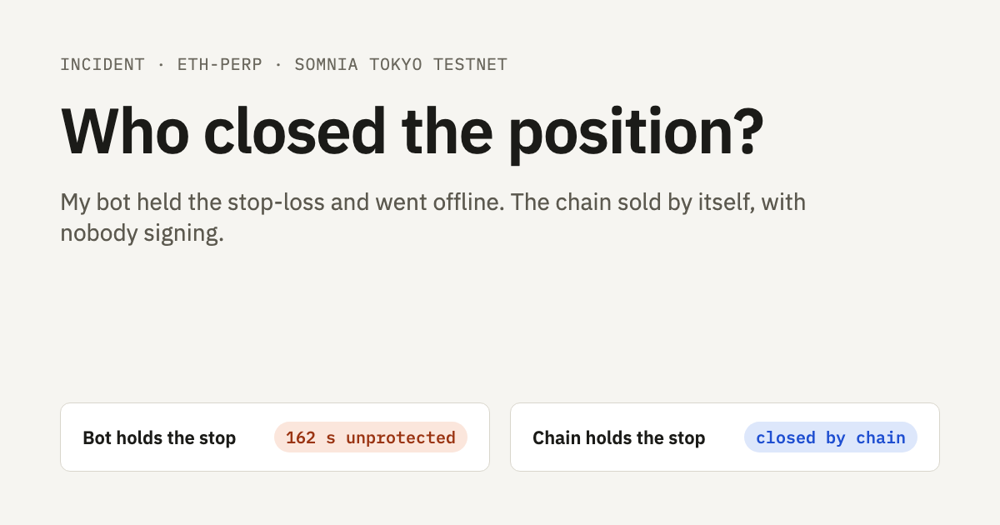

# Who closed the position? A bot stop-loss vs a chain stop-loss

A live, reproducible demo on Somnia Tokyo testnet. Two accounts hold the same
0.01 ETH long on the dreamDEX ETH perp with the same stop-loss:

- **Bot holds the stop.** A script polls the price every 2 s and would send the sell.
  A few seconds in, the demo cuts its connection, the way an RPC outage or a dead
  server would.
- **Chain holds the stop.** A contract ([`src/ChainStop.sol`](src/ChainStop.sol)) is its
  own perps account. It asks Somnia to wake it every 5 s (Reactivity `Schedule`
  event). When it wakes at or below the stop, it sells. Nobody signs that transaction.



## The recorded run (2026-10-21)

| | |
|---|---|
| Stop | $2,462.39 |
| Bot's connection cut | 4.6 s after the stop was set |
| Chain checks while waiting | 27, every ~5 s, all above the stop |
| Price first at the stop | 137.1 s |
| Chain sold | 143.0 s at $2,461.78, tx `0x2f44a581caa614d317e62ee67ccb003cc9b1b3447845a47e0487e26c121c2c87` |
| Bot came back and sold | 166.6 s at $2,463.02 |
| Time the bot's position had no working stop | 162 s |

The close transaction's sender is the contract itself
(`0x09e201dAF194DdC18345bd26cb6fD23E954Cd565`): Somnia delivers a reaction as a
transaction from the subscription owner, so no key signed it. In this run the price
bounced, so the bot's late sale landed above the stop; the point is the 162 s with
no protection, not the P&L. Full timeline: [`site/runs/featured.json`](site/runs/featured.json).

## How the contract stays awake

```solidity
function onEvent(address, bytes32[] calldata, bytes calldata) external {
    require(msg.sender == REACTIVITY, "only chain");
    (bool ok, uint256 mark) = pool.tryGetMarkPrice();
    if (ok && mark <= stopPrice) { _close(mark); return; }
    _scheduleNext(); // one-shot Schedule(now + 5 s), renewed every wake-up
}
```

- The contract must hold **32 STT** when it books a wake-up (a spam check, not a fee).
- Each wake-up and the sale are paid from its balance: a run of ~28 wake-ups plus the
  close cost about **0.09 STT**. The close used 1.65M gas.
- dreamDEX's own perps TP/SL work the same way: their stop contracts are woken every 5 s.

Fine print: the check runs every 5 s, so a stop fires up to ~5 s after the cross (6 s
here). It reads dreamDEX's smoothed mark price, so a very short wick may not trigger it.

## Run it

```bash
npm install
forge build                                   # contract (foundry)
node scripts/setup.mjs 60                     # give the bot account perps margin
node server.mjs                               # board on http://localhost:8810, press Start
```

- Key: a throwaway testnet key read from `~/.tokyo-throwaway/key` (override with
  `KEY_FILE`). It is never printed or sent to the page.
- Deploy on Somnia with a generous gas limit (the contract needed 21.5M; give 45M) and
  check the receipt status and code size before sending it funds. Fund it with 32+ STT
  and margin via `fund(uint256)`.
- Knobs (env): `STOP_OFFSET_USD` (1), `BOT_DIES_AT_MS` (3000), `RECONNECT_AFTER_MS`
  (20000), `MAX_RUN_MS` (600000), `CHAIN_STOP` (contract address).
- Replay a saved run with no keys and no trades: `/?replay=/runs/<file>.json`.
  Long quiet stretches play at x10 under a visible "fast-forward" badge.
- `node scripts/render-card.mjs runs/<file>.json` renders the clip (ProRes 4444 + alpha,
  VP9 + alpha, MP4). `node scripts/build-site.mjs runs/<file>.json` builds `site/`.
